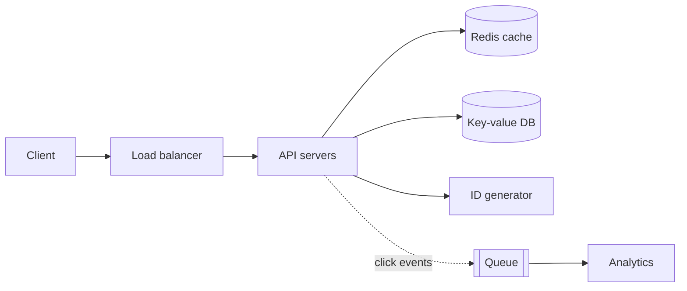

## 1. Requirements

**Functional**

- Given a long URL, return a short one, for example `hnguyen.uk/s/aZ3k9`.
- Visiting the short URL redirects to the original.
- Optional: custom aliases, expiry, click analytics.

**Non-functional**

- Reads far outnumber writes, roughly 100:1.
- Redirects must be fast (p99 under 50 ms) and highly available.
- Short codes must be unique and hard to guess.

## 2. Back-of-the-envelope

Say 100M new URLs a month, which is about **40 writes/s** and **4,000 reads/s** on average.
Over 5 years that's 6 billion URLs. At about 500 bytes each, that's roughly **3 TB** of storage.

A 7-character base62 code gives 62⁷ ≈ **3.5 trillion** combinations, which is plenty.

## 3. High-level design



## 4. Generating short codes

| Approach | Pros | Cons |
| --- | --- | --- |
| Hash (MD5) of URL, take 7 chars | Stateless, same URL gives same code | Collisions need a check and retry |
| Counter + base62 encode | No collisions, short | Codes are guessable; counter is a bottleneck |
| Pre-generated key ranges per server | Fast, no coordination per request | A little more to operate |

A good answer: give each API server a **range of IDs** (from ZooKeeper or a DB sequence),
encode them in base62, and optionally shuffle the bits so codes are not sequential.

<details>
<summary>Base62 encoding (Python)</summary>

```python
ALPHABET = "0123456789abcdefghijklmnopqrstuvwxyzABCDEFGHIJKLMNOPQRSTUVWXYZ"

def encode(n: int) -> str:
    if n == 0:
        return ALPHABET[0]
    out = []
    while n:
        n, r = divmod(n, 62)
        out.append(ALPHABET[r])
    return "".join(reversed(out))
```

</details>

## 5. Reads, caching and redirects

- Put a cache (Redis) in front of the DB. The hottest 20% of links serve most traffic.
- Return **302** if you want to count every click, or **301** if you'd rather browsers cache
  the redirect and take load off your servers.
- A key-value store (DynamoDB, Cassandra) fits well: you look up by key and never join.

## 6. Things to bring up if time allows

- Rate limiting and abuse (malware links), expiry and cleanup jobs.
- Multi-region replication; reads can be served from the nearest region.
- Analytics via an async queue, so redirects stay fast.
